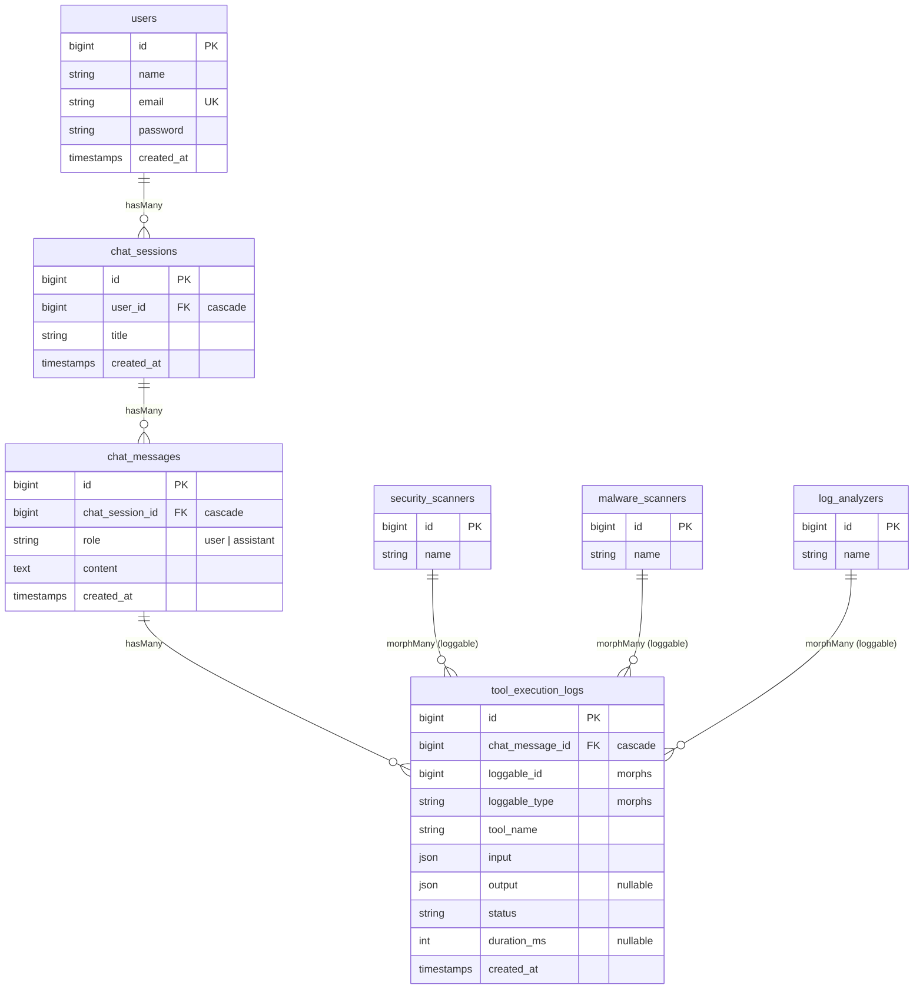

# Agentic AI Platform - Relasi Antar Model & Eager Loading

Tugas PBKK Pertemuan 9: skema basis data relasional untuk sesi obrolan, isi pesan, dan log pemanggilan alat (tool calling) oleh agent AI.

## ERD



## Relasi Model

| Model | Relasi | Tipe |
|---|---|---|
| `User` | `chatSessions()` | `hasMany(ChatSession)` |
| `ChatSession` | `user()` / `messages()` | `belongsTo(User)` / `hasMany(ChatMessage)` |
| `ChatMessage` | `chatSession()` / `toolExecutionLogs()` | `belongsTo(ChatSession)` / `hasMany(ToolExecutionLog)` |
| `ToolExecutionLog` | `chatMessage()` / `loggable()` | `belongsTo(ChatMessage)` / `morphTo()` |
| `SecurityScanner`, `MalwareScanner`, `LogAnalyzer` | `logs()` | `morphMany(ToolExecutionLog, 'loggable')` via trait `HasToolExecutionLogs` |

- Semua foreign key memakai `foreignId()->constrained()->cascadeOnDelete()`: menghapus user ikut menghapus sesi, pesan, dan log.
- Kolom morph (`loggable_id`, `loggable_type`) tidak bisa diberi foreign key, jadi cascade saat agent dihapus dilakukan oleh trait `HasToolExecutionLogs` (event `deleting`).

## Challenge A+

1. **Polymorphic logging**: `tool_execution_logs` memakai `$table->morphs('loggable')`, sehingga satu tabel log dipakai bersama oleh `SecurityScanner`, `MalwareScanner`, dan `LogAnalyzer`. Log tetap `belongsTo` pesan yang memicunya.
2. **Optimasi kueri riwayat obrolan** di `ChatSessionController@show`:

   ```php
   $chatSession->load([
       'user',
       'messages' => fn ($query) => $query->oldest(),
       'messages.toolExecutionLogs.loggable',
   ]);
   ```

   Jumlah query tetap konstan berapa pun banyaknya pesan dan log: pesan, log, lalu 1 query per tipe agent.
   Halaman daftar (`index`) memakai `withCount('messages')` sehingga jumlah pesan dihitung di database tanpa memuat isinya.

Bukti bebas N+1 (Laravel Debugbar, `/chat-sessions/1`): **9 statement** total. Semua relasi dimuat dengan satu query `WHERE ... IN (...)` per tabel; tidak ada query berulang per pesan atau per log.


| # | Query | Asal |
|---|---|---|
| 1-3 | session, user login, `chat_sessions` (route binding) | middleware & routing |
| 4 | `chat_messages WHERE chat_session_id IN (1)` | eager `messages` |
| 5 | `tool_execution_logs WHERE chat_message_id IN (1,2,3,4)` | eager `messages.toolExecutionLogs` |
| 6-8 | `log_analyzers` / `malware_scanners` / `security_scanners WHERE id IN (...)` | eager `loggable` (1 query per tipe agent) |
| 9 | update session | middleware |

Pengaman tambahan:
- `Model::preventLazyLoading()` aktif di luar production (`AppServiceProvider`), jadi lazy loading langsung melempar exception.
- Test `halaman riwayat obrolan bebas N+1 query` membandingkan jumlah query untuk sesi dengan 1 pesan vs 10 pesan dan memastikan keduanya sama.

## Autentikasi (Laravel Breeze)

- `User` berasal dari Breeze (Blade + Pest). Halaman `/chat-sessions` berada di dalam middleware `auth`.
- `ChatSessionPolicy@view` memastikan user hanya bisa membuka sesi miliknya sendiri (403 untuk sesi orang lain).
- Akun demo dari seeder: `test@example.com` / `password`.

## Menjalankan

```bash
composer install
npm install && npm run build
cp .env.example .env
php artisan key:generate
php artisan migrate:fresh --seed   # 5 user, 15 sesi, 60 pesan, 120 log
php artisan serve                  # login test@example.com / password, buka /chat-sessions
php artisan test --compact
```
